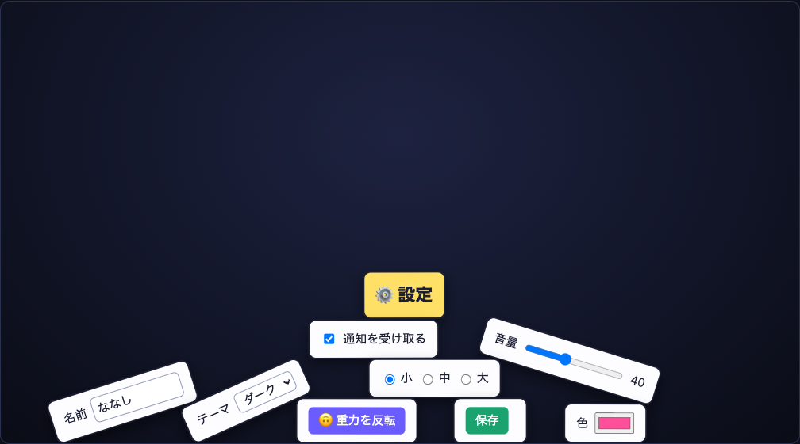

# HTML-in-Canvas Playground

[HTML-in-Canvas](https://developer.chrome.com/docs/web-platform/html-in-canvas) で遊ぶデモ集。`<canvas>` の子要素に置いた本物の HTML を canvas や WebGL に描き、変形したままでも入力やクリックができることを試す。



## デモ

| タブ | 使っている API | 内容 |
| --- | --- | --- |
| 崩れる設定画面 | 2D `drawElementImage()` | 設定画面の部品を Matter.js の剛体にして崩す。転がった input や select もそのまま操作できる |
| CRT ターミナル | WebGL2 `texElementSubImage2D()` | HTML のターミナルをテクスチャにして、ブラウン管風のシェーダ (歪み、走査線、色ずれ、グリッチ) で描く。`help` でコマンド一覧 |
| 万華鏡メモ | 2D `drawElementImage()` + `preserveElementGeometry` | 付箋を扇形にクリップして何枚も描く。中央の 1 枚だけが操作できる本物 |
| 3D パネル | three.js + `texElementSubImage2D()` + `updateElementGeometry()` | three.js のシーンに浮かぶ板に ToDo アプリを貼る。遠近変換の 4x4 行列をそのまま渡すので、傾いた板の上でもクリック位置がずれない |

## 動かす

HTML-in-Canvas に対応したブラウザが要る。

- Chrome 157 以降 (Stable は 2026-11-03 予定)
- Chrome Canary
- それより前の Chrome では `chrome://flags/#canvas-draw-element` を有効にする

ビルドはない。`site/` を静的に配信して開く。

```
make serve  # http://localhost:8000/
```

## メモ

- Canary 158 時点で使えるのは `drawElementImage()`、`texElementSubImage2D()`、`getElementImageDefaultSize()`、`updateElementGeometry()`。WebGPU 用の API と、旧名の `texElementImage2D()` はない
- Chrome 156 (フラグで有効化) には `getElementImageDefaultSize()` がなく、代わりに `texElementImage2D(target, internalformat, element)` がテクスチャの確保と書き込みを一度に行う。`util.js` の `uploadElementTexture()` で両方に対応している
- three.js r186 の `HTMLTexture` は旧名の `texElementImage2D()` を呼ぶので、Canary 158 では動かない。テクスチャを自前で作って `texElementSubImage2D()` で更新し、`THREE.ExternalTexture` で three.js に渡している。生の GL を呼んだ後は `renderer.resetState()` が要る
- 2D の `drawElementImage()` はヒットテスト用のジオメトリを自動で更新する。WebGL では自動更新されないので、`updateElementGeometry()` に canvas 上の変換を渡す
- 描画は `requestAnimationFrame` ではなく canvas の `paint` イベントで行い、毎フレーム `requestPaint()` する。要素が変わったかは `event.changedElements` でわかる
