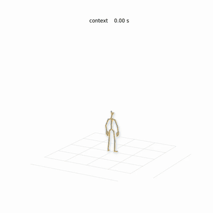

# MotionBricks on Colab

[NVlabs/motionbricks](https://github.com/NVlabs/motionbricks) (SIGGRAPH 2026) を Colab の T4 で動かす。MotionBricks は、直近の 4 姿勢と、到達させたい 1〜4 姿勢を渡すと、その間をつなぐモーション (0.6〜1.9 秒) を生成するモデル。生成を連鎖させると、長いモーションになる。

ここでは SOMA (人体) モデルを使い、同梱のサンプルクリップから取った姿勢を順に置いてつなぎ、BVH と骨格の動画を書き出す。



緑は最初の文脈の姿勢、青は生成したモーション、橙は向かっている目標姿勢。

## 必要なもの

公式の実行環境は TensorRT を使うので NVIDIA GPU が要る。Mac では動かないため、Colab の GPU ランタイムを [Colab CLI](https://pypi.org/project/google-colab-cli/) から使う。

```sh
uv tool install google-colab-cli
colab sessions  # 初回はブラウザで認証する
```

## 実行

```sh
make session   # T4 のセッションを作る。stop するまで使い回す
make run       # スクリプトとシナリオを置き、motionbricks.ipynb を実行する
make download  # out/ に <シナリオ名>.bvh と .mp4 を取ってくる
make stop      # セッションを止める
```

`make run` は `motionbricks_output.ipynb` にセルの出力を書く。初回はセットアップ (clone、Git LFS で ONNX 2.2 GB、`uv sync`) と TensorRT プランのビルドで数分かかる。2 回目からは、同じセッションならセットアップを飛ばし、生成もすぐ終わる。

Colab の Web UI で実行する場合は、`motionbricks.ipynb` を開き、`generate.py`、`render.py`、`scenarios/` を `/content/work/` にアップロードしてから実行する。

## ファイル

| ファイル | 内容 |
| --- | --- |
| `motionbricks.ipynb` | セットアップ、生成、描画、表示を行うノートブック |
| `generate.py` | シナリオから生成し、`out/<名前>.bvh` と `.npz` を書く。MotionBricks の venv で実行する |
| `render.py` | npz から骨格の動画 `out/<名前>.mp4` を描く。matplotlib と ffmpeg を使う |
| `scenarios/*.json` | どのクリップのどの姿勢を、どこに置くか |

## シナリオ

```json
{
  "start": {"clip": "locomotion/idle/idle_loop_001__A268", "time": 1.0},
  "steps": [
    {"clip": "variations/zombie_walk_180_R_003__A330", "time": 2.0, "forward": 2.0},
    {"clip": "locomotion/idle/crouch_idle_001__A529", "time": 1.0, "forward": 2.0, "turn": 90, "targets": 1}
  ]
}
```

- `start`: `clip` の `time` 秒で終わる 4 姿勢を、最初の文脈にする
- `steps`: 目標姿勢を 1 つずつ置き、そこまでのモーションを生成する。前の生成の最後の 4 姿勢が次の文脈になる
  - `clip`、`time`: `time` 秒から 30 Hz で `targets` 個 (1〜4、既定 4) の姿勢を取る。1 姿勢ならそこで止まり、4 姿勢ならその先の動き方まで指定する
  - `forward`、`side`、`turn`: 直前の到達点から見て、前方 `forward` m、左 `side` m に、向きを `turn` 度 (左回りが正) 変えて置く

クリップの名前は MotionBricks の `assets/motions/soma/` からの相対パス (拡張子なし)。

## メモ

- T4 でも問題なく動く。TensorRT プランのビルドを含めて、初回の生成は 97 秒だった
- 付属の GUI デモ (Inbetweener、Scene Preview、エディタ) はウィンドウを開くので、Colab では使えない。このエントリは、ビューアなしで呼べる `motionbricks` パッケージだけを使う
- 生成の長さは既定で 8〜14 トークン (4 姿勢 / トークン) から選ばれる。目標を 2〜3 m 先に置いた `tour.json` では、どの区間も上限の 14 トークン (50 フレーム) になった
- 書き出す BVH は、最初のクリップの BVH の階層をそのまま使う。生成した骨格にない Root は原点に固定する
- モデルは NVIDIA Open Model Agreement、サンプルモーションは NVIDIA Sample Data Evaluation License。サンプルクリップや、その階層を使った BVH はリポジトリに置かない
