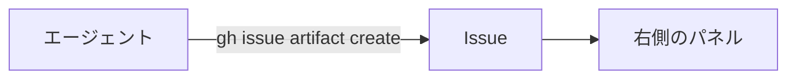

# 06 Markdown

Issue 本文と同じ GFM として描画されるかを見る。

## 表とタスクリスト

| 項目 | 値 |
| --- | ---: |
| A | 100 |
| B | 60 |

- [x] 済み
- [ ] 未着手

## Alert

> [!NOTE]
> NOTE の alert

> [!WARNING]
> WARNING の alert

## 折りたたみ

<details>
<summary>開く</summary>

折りたたまれた中身

</details>

## Mermaid



## 数式

$$
\sum_{i=1}^{n} i = \frac{n(n+1)}{2}
$$

インライン: $e^{i\pi} + 1 = 0$

## 画像

相対パス:


絶対 URL:


## コード

```js
console.log("syntax highlight");
```

## メンションと参照

#1 のような Issue 参照や `@` 付きのメンションがリンクになるか (メンションは通知が飛ぶので書かない)。
