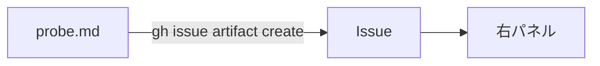

# Issue Artifact Probe (Markdown)

Markdown の Artifact で、Issue 本文と同じ記法がどこまで描画されるかを確かめる。

## 表

| 項目 | 値 |
| --- | ---: |
| alpha | 1,024 |
| beta | 42 |

## タスクリスト

- [x] 完了した項目
- [ ] 未完了の項目

## アラート

> [!NOTE]
> NOTE のアラート

> [!WARNING]
> WARNING のアラート

## 折りたたみ

<details>
<summary>開く</summary>

折りたたみの中身

</details>

## 数式

$e^{i\pi} + 1 = 0$

$$
\sum_{k=1}^{n} k = \frac{n(n+1)}{2}
$$

## Mermaid



## コードのハイライト

```js
const greet = (name) => `hello, ${name}`;
```

## 画像 (--attach で添付)


## 自動リンク

- コミット SHA: 57ea531
- URL: https://example.com/
